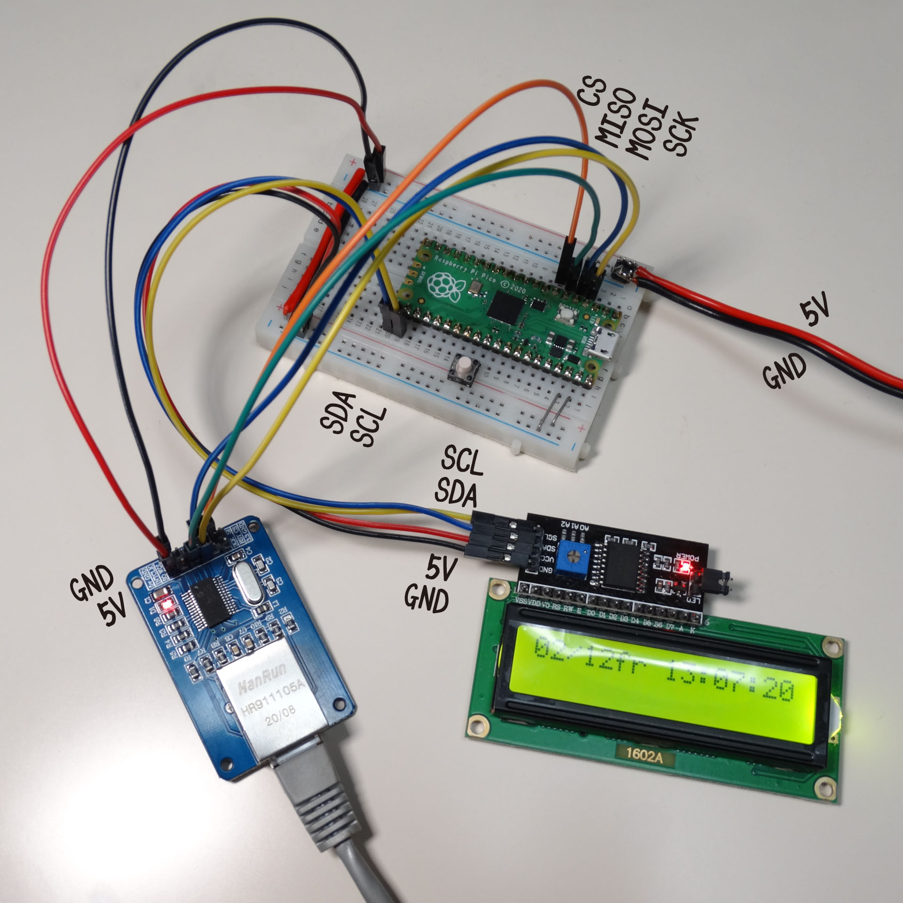

# pico-ntpclock

A wired network clock built with a Raspberry Pi Pico, an ENC28J60 Ethernet module, and a 16×2 character LCD. It synchronizes with `ntp.nict.jp` over NTP and displays Japan Standard Time (JST, UTC+9). You can also read the current time over HTTP from another device on the LAN.



## Hardware and wiring

Use a Raspberry Pi Pico (RP2040), an ENC28J60 Ethernet module, and a 16×2 LCD with a PCF8574-compatible I²C backpack at address `0x27`. Connect the Ethernet module to a LAN with a DHCP server and access to the NTP server.

| Module | Signal | Pico GPIO |
| --- | --- | --- |
| ENC28J60 (SPI0) | SCK | GP2 |
| ENC28J60 (SPI0) | MOSI | GP3 |
| ENC28J60 (SPI0) | MISO | GP4 |
| ENC28J60 (SPI0) | CS | GP5 |
| LCD (I²C0) | SDA | GP16 |
| LCD (I²C0) | SCL | GP17 |

Connect all grounds together and use the supply voltage specified for each module. The Pico GPIO uses 3.3 V logic. If your LCD backpack pulls SDA and SCL up to 5 V, use an I²C level shifter.

## Build and flash

Install the Raspberry Pi Pico SDK, the Arm GNU toolchain (`arm-none-eabi`), CMake, and GNU Make. From the repository root, run `make` if the SDK is at `~/pico/pico-sdk`. For a different SDK location, pass its path to Make.

```sh
make PICO_SDK_PATH=/path/to/pico-sdk
```

Hold **BOOTSEL** while connecting the Pico to your computer over USB, then copy `build/ntpclock.uf2` to the `RPI-RP2` drive. The Pico restarts and runs the firmware.

## Using the clock

On startup, the bottom LCD row shows the Ethernet connection or DHCP status, then the assigned IPv4 address. The top row shows `Waiting for NTP` until the first successful sync, then displays the date, weekday, and time.

The clock normally resynchronizes every 30 minutes. Between syncs it uses the Pico's timer to keep time, even if the network goes down. After an hour without a successful sync, the LCD adds an asterisk (`*`) next to the weekday.

To read the clock over HTTP, open `http://<pico-ip>/` using the address shown on the LCD. Both `/` and `/index.html` return a plain-text timestamp such as `2026-11-24 14:30:00 JST`. Before the first sync, the server returns `503 Service Unavailable`. When the clock continues with an older sync, the timestamp ends with `(stale)`. The `X-Clock-Status` response header reports `waiting`, `synchronized`, or `stale`.

## Source layout

- The main loop polls the network, synchronizes the clock, and updates the display. The same file formats HTTP responses. [main.cpp](main.cpp)
- The IPv4 stack handles ARP, ping replies, DHCP lease renewal, DNS caching, UDP, and the TCP connections used by the HTTP server. [ip.cpp](ip.cpp)
- The Ethernet driver sends and receives frames through the ENC28J60 over SPI. [enc28j60.c](enc28j60.c) · [enc28j60io.c](enc28j60io.c)
- The LCD driver writes text to the display over I²C. [lcd.c](lcd.c)
